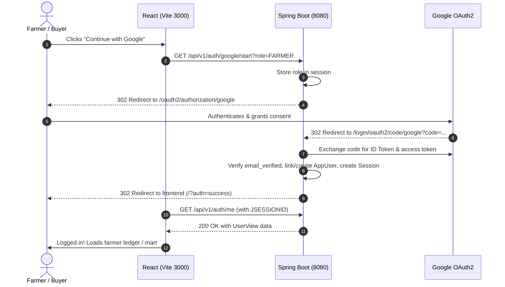

# Google OAuth 2.0 Setup Guide for KisanKhata

This guide provides the exact configuration required in the **Google Cloud Console** and your environment to enable server-side Google Authentication ("Continue with Google") for KisanKhata.

---

## 1. Google Cloud Console Configuration

Since you already have a Web application OAuth 2.0 Client ID and Client Secret, verify the following settings:

### A. OAuth Consent Screen
1. Go to [Google Cloud Console](https://console.cloud.google.com/) -> **APIs & Services** -> **OAuth consent screen**.
2. **User Type:** Select **External**.
3. **App Information:**
   - App name: `KisanKhata`
   - User support email: Select your email
   - Developer contact email: Enter your email
4. **Scopes:**
   - Add scopes: `openid`, `.../auth/userinfo.email`, `.../auth/userinfo.profile`.
5. **Test Users (Crucial while in "Testing" publishing status):**
   - Click **Add Users**.
   - Add your Google account email and any test user Gmail addresses.
   - *Note: In Testing mode, only added test users can sign in. Once verified or ready, you can click "Publish App".*

### B. Credentials (OAuth 2.0 Client IDs)
1. Go to **APIs & Services** -> **Credentials**.
2. Select your existing OAuth 2.0 Client ID (Application type: **Web application**).
3. Configure the URIs as follows:

#### **Authorized JavaScript origins:**
```
http://localhost:3000
http://localhost:5173
https://kisan-khata-x1dp.vercel.app
```
*(Add your custom production frontend domain if different).*

#### **Authorized redirect URIs (CRITICAL - Must point to the Backend):**
```
http://localhost:8080/login/oauth2/code/google
https://<your-backend-domain>/login/oauth2/code/google
```
For example, if your backend is deployed on Render:
```
https://kisankhata-1.onrender.com/login/oauth2/code/google
```

4. Click **Save**.

---

## 2. Environment Variables Configuration

### Backend Environment Variables (`backend/.env` or Host Environment)

Set the following variables on your backend host (Render, Railway, Docker, or local machine):

| Variable | Local Development | Production (e.g., Render) |
| :--- | :--- | :--- |
| `GOOGLE_CLIENT_ID` | `your-client-id.apps.googleusercontent.com` | `your-client-id.apps.googleusercontent.com` |
| `GOOGLE_CLIENT_SECRET` | `GOCSPX-your-client-secret` | `GOCSPX-your-client-secret` |
| `FRONTEND_ORIGIN` | `http://localhost:3000` | `https://kisan-khata-x1dp.vercel.app` |
| `SESSION_COOKIE_SAMESITE` | `lax` | `none` |
| `SESSION_COOKIE_SECURE` | `false` | `true` |

> **SECURITY NOTE:** Never commit `.env` or paste `GOOGLE_CLIENT_SECRET` into version control, frontend code, or Docker images. The Client Secret is used **only** by Spring Boot server-side to exchange authorization codes with Google.

### Frontend Environment Variables (`frontend/.env`)

| Variable | Local Development | Production (e.g., Vercel) |
| :--- | :--- | :--- |
| `VITE_API_BASE_URL` | `http://localhost:8080` | `https://kisankhata-1.onrender.com` |

---

## 3. How to Run Locally with Google Auth

### Option A: Using `backend/.env` (Recommended for Local Dev)
1. In `backend/`, copy `.env.example` to `.env`:
   ```bash
   cp backend/.env.example backend/.env
   ```
2. Open `backend/.env` and paste your `GOOGLE_CLIENT_ID` and `GOOGLE_CLIENT_SECRET`:
   ```properties
   GOOGLE_CLIENT_ID=your-client-id.apps.googleusercontent.com
   GOOGLE_CLIENT_SECRET=GOCSPX-your-client-secret
   FRONTEND_ORIGIN=http://localhost:3000
   ```
3. Run `run.bat` or `run-dev.ps1` from the root folder. Both scripts automatically detect and load `backend/.env` into the process environment!

### Option B: Setting in PowerShell Terminal
```powershell
$env:GOOGLE_CLIENT_ID="your-client-id.apps.googleusercontent.com"
$env:GOOGLE_CLIENT_SECRET="GOCSPX-your-client-secret"
$env:FRONTEND_ORIGIN="http://localhost:3000"
.\run-dev.ps1
```

---

## 4. Production Cross-Domain Cookie Requirements

When the frontend is deployed on Vercel (`https://kisan-khata-x1dp.vercel.app`) and the backend is on a separate domain (e.g., Render `https://kisankhata-1.onrender.com`):
1. **Third-Party Cookies:** Browsers treat cross-domain cookies as third-party. The backend must send `SameSite=None; Secure`.
   - Set `SESSION_COOKIE_SAMESITE=none`
   - Set `SESSION_COOKIE_SECURE=true`
2. **Reverse Proxy Headers:** Render and Cloud Run terminate TLS at their edge proxy. Spring Boot has `server.forward-headers-strategy: framework` enabled in `application.yml`, ensuring that `X-Forwarded-Proto: https` is respected so the Google OAuth redirect URI is generated with `https://`.
3. **CORS:** Ensure `FRONTEND_ORIGIN` matches the exact frontend origin (without trailing slash).

---

## 5. End-to-End Authentication Flow



